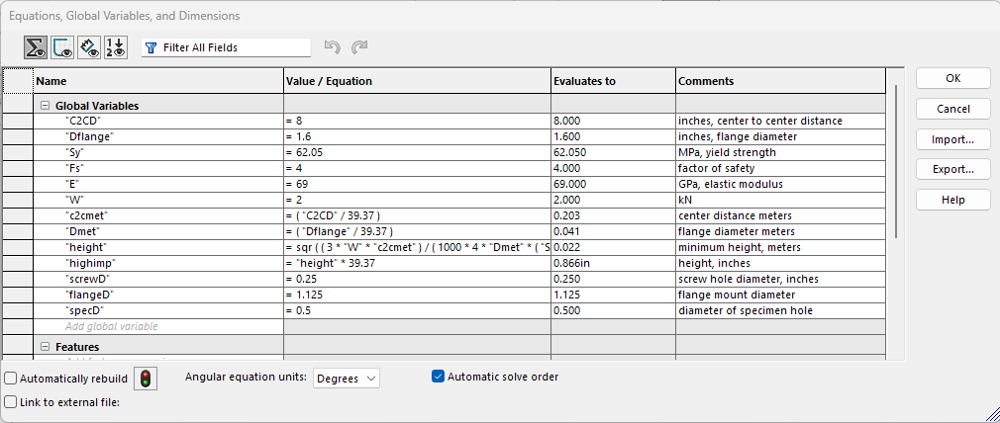
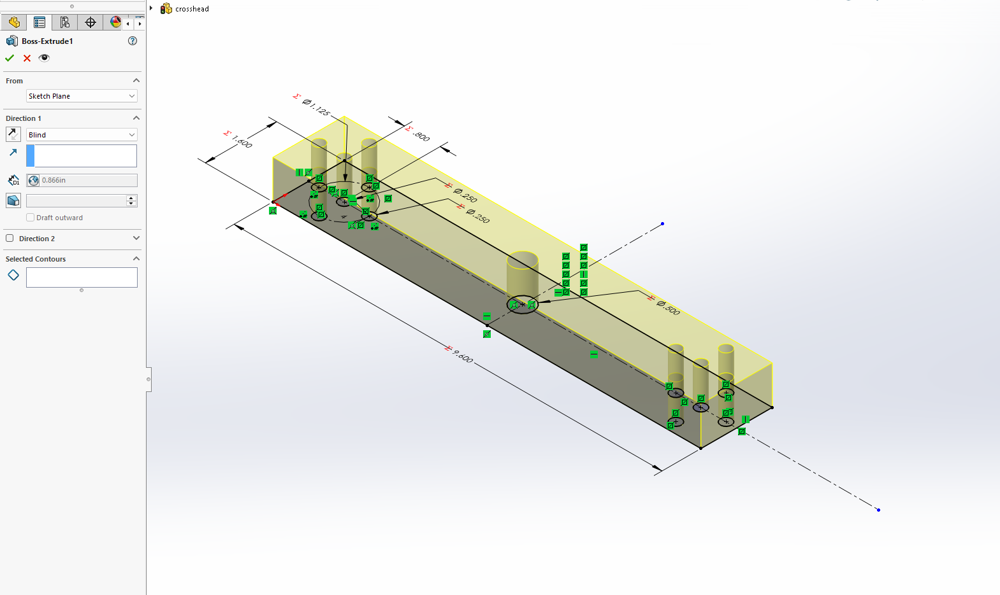

So that everyone has the same portfolio to submit, it will be condensed here.

Not done YET - Aidan

# A10 – Lead Screw Tensile Tester
# ISAIAH LITTLE: Lead Screw System Design — Tensile Tester 

## Project Overview

This document records my design process for the lead-screw system used in a tensile tester. It includes my calculations, component selections, design decisions, assumptions, and revisions.

The tensile tester uses **two identical lead screws** to move the crosshead and apply a maximum tensile force of **2,000 N** to the test specimen.

The design process includes:

- Lead-screw sizing and selection.
- Bronze nut selection and internal thread analysis.
- Nut-to-flange component selection.
- Flange-to-crosshead bolted connection analysis.

I have distinguished confirmed component selections from assumed material properties and dimensions that still require verification.

---

## 1. Design Requirements and Initial Knowns

| Parameter | Symbol | Value |
|---|---|---:|
| Maximum specimen tensile force | FT | 2,000 N |
| Number of lead screws | ns | 2 |
| Design factor of safety for screw sizing | N | 4 |
| Required crosshead speed | v | 1–50 mm/min |
| Minimum lead-screw length | — | 18 in |
| Assumed screw material for initial calculations | — | AISI 1020 cold-drawn steel |
| Assumed screw yield strength | Sy | 350 MPa |

I initially selected AISI 1020 cold-drawn steel for my screw strength calculations and used an assumed yield strength of 350 MPa. The exact material grade of the purchased screw has not been independently verified.

I assumed the tensile load would be shared equally between the two lead screws:

Fs=FTns

Fs=20002

$\boxed{F_s=1000\text{ N per screw}}$

This assumption requires the two screws to be properly aligned and driven synchronously.

---

## 2. Minimum Screw Diameter from Axial Stress

I calculated the minimum required screw diameter using the axial normal-stress relationship:

=FA

For a solid circular shaft:

A=d24

For a factor of safety of 4, the allowable stress is:

allow=SyN

allow=3504

$\boxed{\sigma_{\text{allow}}=87.5\text{ MPa}}$

Solving for the minimum diameter:

d=4Fsallow

Substituting the load carried by one screw:

d=4(1000)(87.5106)

$\boxed{d_{\min}=3.815\text{ mm}}$

This is the theoretical minimum diameter based on axial stress alone.

For a threaded screw, I used the minor (root) diameter for this preliminary check because it represents the smallest nominal cross-section. Manufacturing tolerances and other possible failure modes must also be considered.

---

## 3. Lead Selection and Rotational Speed

My initial goal was to use a relatively small lead so that the crosshead displacement per revolution would be small. I initially considered a lead of 1 mm/rev.

After finding an available commercial screw with a lead of 0.050 in/rev, I changed the design to match the available component.

Converting the lead:

L=0.050(25.4)

$\boxed{L=1.27\text{ mm/rev}}$

The relationship between crosshead linear speed and screw rotational speed is:

v=nL

Solving for rotational speed:

n=vL

At the minimum crosshead speed:

n=11.27

$\boxed{n_{\min}=0.787\text{ RPM}}$

At the maximum crosshead speed:

n=501.27

$\boxed{n_{\max}=39.37\text{ RPM}}$

Therefore, the required rotational speed range is:

$\boxed{n=0.787\text{ to }39.37\text{ RPM}}$

Both screws must rotate synchronously to keep the crosshead level.

A smaller lead improves displacement resolution per revolution, but it does not automatically guarantee positioning accuracy. Backlash, thread tolerances, bearing play, structural stiffness, motor control resolution, and load-cell feedback also affect positioning and force control.

---

## 4. Thread Type and Nut Material Decisions

I selected an **Acme-style power-screw thread** because it is commonly used in power-transmission applications.

For a standard Acme thread, the included thread angle is 29 degrees. Therefore, the half-angle is:

=292

$\boxed{\alpha=14.5^\circ}$

I initially considered using a steel nut but changed the nut material to **bronze**.

I chose bronze because a steel screw and bronze nut combination is commonly used in sliding power-screw applications. This material pairing can reduce the likelihood of galling compared with dry steel-on-steel contact.

I also selected lubricated screw/nut contact for the preliminary torque calculation. I assumed:

$\boxed{\mu=0.15}$

This coefficient of friction is an assumption, not a verified value for the exact bronze alloy, lubricant, surface finish, and operating conditions.

---

## 5. First Lead-Screw Candidate

My first candidate was the Roton 3/16–20 Stub Acme steel lead screw, part **62240**.

[Roton 3/16–20 Stub Acme Steel Lead Screw](https://www.roton.com/product/stub-acme-lead-screw-3-16-20-rh-steel/)

The dimensions I recorded from the product information were:

| Parameter | Value |
|---|---:|
| Major diameter | 0.188 in = 4.775 mm |
| Minor diameter | 0.151 in = 3.835 mm |
| Lead | 0.050 in/rev = 1.27 mm/rev |

The nominal minor diameter exceeded my calculated minimum:

3.835mm>3.815mm

However, the margin was very small:

3.835-3.815=0.020mm

More importantly, the bronze nut's published operating load rating was below the load required per screw.

The required load per screw was:

Fs=1000N

Converting to pounds-force:

Fs=10004.44822

$\boxed{F_s\approx224.8\text{ lbf}}$

The operating load rating I identified for the bronze nut was 75 lbf.

Because the screw and nut assembly would move while applying tension, I decided not to use this first candidate.

This was an important design lesson: checking only the screw's diameter was not enough. I also needed to check the operating load rating of the nut.

---

## 6. Selected Lead Screw: Roton 1/4–20 Acme Steel Screw

I selected the larger Roton 1/4–20 Acme steel screw, part **60758**.

[Roton 1/4–20 Acme Steel Screw — Part 60758](https://www.roton.com/product/acme-steel-screw-right-60758/)

The manufacturer information I recorded for this candidate was:

| Parameter | Value |
|---|---:|
| Thread | 1/4–20 Acme |
| Major diameter | 0.250 in = 6.350 mm |
| Minor diameter | 0.175 in = 4.445 mm |
| Lead | 0.050 in/rev = 1.270 mm/rev |
| Bronze-nut static load rating | 1,000 lbf |
| Bronze-nut operating load rating | 300 lbf |
| Forward-drive efficiency | 32% |
| Drive torque ratio | 0.025 in·lbf/lbf |

### 6.1 Minor Diameter Check

My calculated minimum diameter was:

d=3.815mm

The selected screw's nominal minor diameter is:

dminor=4.445mm

Therefore:

4.445mm>3.815mm

The nominal minor diameter exceeds the calculated minimum by:

4.445-3.815=0.630mm

This candidate provides a larger nominal diameter margin than my first selection.

### 6.2 Bronze Nut Operating Load Check

The load per screw is approximately 224.8 lbf.

The operating load rating I recorded for the selected candidate was 300 lbf:

224.8lbf<300lbf

Therefore, the required load per nut is below the operating load rating I identified.

This comparison assumes that the rating applies to the exact compatible bronze nut and the intended operating conditions. The manufacturer's rating conditions should be verified before finalizing the design.

### 6.3 Material Verification

Roton identifies the screw as steel. I selected AISI 1020 cold-drawn steel for my calculations, but I have not independently verified that part 60758 is specifically manufactured from that grade and condition.

I should not claim that the purchased screw has this exact material grade until the manufacturer confirms it.

---

## 7. Lead-Screw Torque and Free-Body Diagram

I completed the mean-diameter work, torque derivation, and free-body diagram for the selected lead-screw system.

For an Acme screw raising a load, the torque per screw is calculated using:

Ts=Fsdm2L+dmdm-L

Where:

- Fs = axial load carried by one screw.
- dm = mean or pitch diameter of the thread.
- L = screw lead.
-  = assumed coefficient of friction.
-  = Acme thread half-angle.

The total torque required for two identical screws is:

Ttotal=2Ts

The final torque values recorded for the selected screw are:

| Parameter | Value |
|---|---:|
| Operating torque per screw | 0.635 N·m |
| Total operating torque for two screws | 1.27 N·m |

The final mean diameter and torque derivation correspond to the selected 1/4–20 screw. The earlier 4.305 mm mean-diameter estimate belonged to the first 3/16-inch candidate and was not reused for the final screw.

I did not multiply the required operating torque by the factor of safety of 4. The factor of safety was applied in the screw strength sizing calculation. A separate torque margin may be appropriate when selecting the motor and drive system.

---

## 8. Bronze Nut and Steel Flange Selection

After selecting the lead screw, I selected a compatible bronze nut and steel mounting flange.

### 8.1 Bronze Nut

I selected the Roton bronze threaded mount nut, part **91734**.

[Roton Bronze Threaded Mount Nut — Part 91734](https://www.roton.com/product/acme-bronze-threaded-mount-nut-right-91734/)

The nut has:

- Internal thread: 1/4–20 Acme.
- External mounting thread: 0.563–18 UNF.
- Bronze construction.

For the preliminary internal-thread analysis, I used C93200 / SAE 660 bronze as the assumed material and a yield strength of 137.9 MPa. The exact alloy should be verified against the supplier's material information.

### 8.2 Steel Mounting Flange

I selected the Roton steel mounting flange, part **89837**, with a matching 0.563–18 UNF center thread.

The recorded flange dimensions are:

| Parameter | Value |
|---|---:|
| Outside diameter | 1.600 in |
| Center thread | 0.563–18 UNF |
| Mounting holes | Four Ø0.266 in holes |
| Mounting-hole bolt circle | 1.125 in |
| Flange thickness | 0.410 in |
| Side feature | 5-40 |

The bronze nut's external mounting thread engages the matching internal thread in the steel flange.

I selected the steel flange to provide the mounting interface between the bronze nut assembly and the crosshead. The exact steel grade of the flange has not been established.

### 8.3 Nut Internal Acme Thread Bearing-Bending Analysis

I previously completed the bearing-bending analysis for the internal Acme threads in the bronze nut that engage the steel lead screw.

For that preliminary calculation, I assumed:

| Parameter | Value |
|---|---:|
| Axial load per nut | 1,000 N |
| Internal Acme thread | 1/4–20 |
| Pitch | 0.050 in = 1.27 mm |
| Mean thread diameter used | 0.225 in = 5.715 mm |
| Assumed full engagement length | 0.625 in = 15.875 mm |
| Number of engaged thread pitches | 12.5 |
| Assumed bronze yield strength | 137.9 MPa |
| Calculated thread bending stress | 38.3 MPa |

The factor of safety from that simplified thread-bearing bending model was:

SF=Syb

SF=137.938.3

$\boxed{SF=3.60}$

This result depends on the assumed full engagement length and bronze material properties. The actual alloy and engagement should be checked against the supplier's specifications.

This analysis applies to the **internal Acme threads of the bronze nut engaging the lead screw**. It is separate from the 0.563–18 UNF mounting interface between the nut and flange.

---

## 9. Flange-to-Crosshead Mounting Design

I decided to mount the steel flange on the **underside of the moving crosshead**.

The flange will be secured using four bolts passing through the flange's clearance holes and threading into tapped holes in the crosshead.

I selected:

- Four 1/4–20 UNC bolts.
- SAE Grade 5 bolt material.
- Four 0.266 in flange clearance holes.
- Tapped 1/4–20 UNC holes in the crosshead.

The crosshead thickness and exact steel grade have not yet been selected.

### 9.1 Load on Each Mounting Bolt

The tensile tester applies 2,000 N to the specimen. Assuming the two lead-screw assemblies share the load equally:

Fassembly=20002

Fassembly=1000N

Each flange therefore transfers an assumed 1,000 N load.

With four mounting bolts and an ideal equal-load-sharing assumption:

Fb=Fassembly4

Fb=10004

$\boxed{F_b=250\text{ N per bolt}}$

This is a preliminary load distribution. Actual bolt loading may differ because of flange stiffness, bolt preload, joint contact, and possible prying.

Because the flange is mounted underneath the crosshead, the tensile load tends to pull the flange away from the crosshead. The mounting bolts therefore experience direct tensile loading in this simplified model.

### 9.2 Tensile Stress in the Grade 5 Bolts

For a 1/4–20 UNC bolt, the tensile stress area is:

At=0.0318in2

Converting the force per bolt to pounds-force:

Fb=2504.44822

Fb=56.20lbf

The tensile stress is:

b=FbAt

b=56.200.0318

$\boxed{\sigma_b=1767\text{ psi}}$

Converting to MPa:

$\boxed{\sigma_b\approx12.18\text{ MPa}}$

For a 1/4 in SAE Grade 5 bolt, I used a minimum yield strength of 92,000 psi and a proof strength of 85,000 psi.

The factor of safety against tensile yielding is:

SFy=Syb

SFy=920001767

$\boxed{SF_y\approx52.1}$

The factor of safety relative to proof strength is:

SFproof=850001767

$\boxed{SF_{\text{proof}}\approx48.1}$

The bolts have a substantial calculated margin against direct tensile yielding under the assumed equal-load-sharing model.

These results do not independently verify the tapped crosshead threads or the complete bolted joint.

### 9.3 Preliminary Internal Thread-Stripping Check in the Crosshead

The next failure mode I evaluated was stripping of the internal 1/4–20 UNC threads tapped into the steel crosshead.

The crosshead thickness and material grade are not yet known. I therefore used a preliminary assumed crosshead steel tensile strength of:

Sut=420MPa

For this estimate, I approximated the material's shear strength as one-half its tensile strength:

Ssu=0.5Sut

Ssu=0.5(420)

$\boxed{S_{su}=210\text{ MPa}}$

This is an assumed material property for preliminary sizing, not a confirmed crosshead specification.

The Industrial Fasteners Institute's thread-strength bulletin lists the internal thread stripping area for a 1/4–20 UNC tapped hole as 0.539 in² per inch of engagement.

[Industrial Fasteners Institute — Calculating Thread Strength](https://www.greensladeandcompany.com/wp-content/uploads/pdf/articles/engineering/Engineering%20-%20Bulletin%20-%20Calculating%20Thread%20Strength.pdf)

Therefore:

Aint=0.539Le

where Le is in inches and Aint is in square inches.

For the preliminary design, I used a target factor of safety of 4 against internal thread stripping:

SF=SsuAintFb

Substituting the stripping-area relationship:

SF=Ssu(0.539Le)Fb

Solving for the required engagement length:

Le=SFFb0.539Ssu

Converting the assumed shear strength to psi:

Ssu=2100.00689476

Ssu30458psi

Substituting the values:

Le=4(56.20)0.539(30458)

$\boxed{L_e=0.0137\text{ in}=0.348\text{ mm}}$

This is the theoretical engagement length from the simplified stripping model. It is shorter than one thread pitch:

P=120=0.050in

I did not use this very short theoretical value as the final preliminary design dimension.

Instead, I selected a practical preliminary engagement target equal to one nominal bolt diameter:

Le=d=0.250in

$\boxed{L_e=0.250\text{ in}=6.35\text{ mm}}$

At this engagement length, the number of engaged thread pitches is:

n=LeP

n=0.2500.050

$\boxed{n=5\text{ thread pitches}}$

The estimated internal thread stripping factor of safety at this engagement length is:

SF=Ssu(0.539Le)Fb

SF=30458(0.539)(0.250)56.20

$\boxed{SF\approx73.0}$

This result is based on the assumed 420 MPa crosshead steel tensile strength, the estimated shear strength, the IFI stripping-area value, and equal load distribution among the four bolts.

### 9.4 Preliminary Crosshead Engagement Requirement

Based on this preliminary calculation, I selected:

$\boxed{L_e=0.250\text{ in}=6.35\text{ mm}}$

as the target usable full-thread engagement for each 1/4–20 UNC mounting bolt.

The crosshead must be thick enough to provide this usable engagement. If the holes are blind, the drilled-hole depth must be greater than the usable full-thread engagement to account for the drill point and incomplete threads at the bottom of the hole.

The actual crosshead material and thickness still need to be selected. The thread-stripping calculation must be revisited using the actual material properties and final hole geometry.

---

## 10. Current Design Record

| Design item | Current selection or status |
|---|---|
| Number of lead screws | Two identical screws |
| Screw manufacturer/product | Roton part 60758 |
| Screw thread | 1/4–20 Acme |
| Screw major diameter | 6.350 mm |
| Screw minor diameter | 4.445 mm |
| Screw lead | 1.270 mm/rev |
| Screw material used in calculations | AISI 1020 cold-drawn steel; exact product grade unverified |
| Nut manufacturer/product | Roton part 91734 |
| Nut material | Bronze; exact alloy to verify |
| Nut internal thread | 1/4–20 Acme |
| Nut external mounting thread | 0.563–18 UNF |
| Flange manufacturer/product | Roton part 89837 |
| Flange material | Steel; exact grade unverified |
| Flange mounting arrangement | Underside of crosshead |
| Number of flange mounting bolts | Four |
| Bolt specification | 1/4–20 UNC SAE Grade 5 |
| Load per flange | 1,000 N |
| Preliminary load per bolt | 250 N |
| Direct bolt tensile stress | 1,767 psi |
| Bolt tensile-yield factor of safety | 52.1 |
| Preliminary crosshead thread engagement | 0.250 in (6.35 mm) |
| Assumed crosshead steel tensile strength | 420 MPa |
| Preliminary thread-stripping factor of safety | 73.0 |
| Final torque per screw | 0.635 N·m |
| Final total operating torque | 1.27 N·m |

---

## 12. Design Decisions and Lessons Learned

1. I began by calculating a minimum screw diameter from axial stress using a factor of safety of 4.
2. I selected Acme threads because they are commonly used in power-transmission applications.
3. I changed the design lead to 1.27 mm/rev to match an available commercial screw.
4. I chose a bronze nut and lubricated contact rather than dry steel-on-steel contact.
5. My first screw candidate passed the nominal diameter check but did not meet the published bronze-nut operating load rating.
6. I selected a larger 1/4–20 screw after checking both its minor diameter and the bronze-nut operating load rating.
7. I selected a compatible bronze threaded mount nut and steel mounting flange.
8. I completed the internal Acme thread-bearing bending analysis for the bronze nut and calculated a factor of safety of 3.60 under the assumed full-engagement condition.
9. I selected four 1/4–20 UNC SAE Grade 5 bolts to attach the flange to the underside of the crosshead.
10. I calculated the direct tensile stress in the mounting bolts and evaluated the tapped crosshead threads for preliminary thread stripping.
11. I learned that a strong bolt does not automatically guarantee a strong bolted connection. The internal threads in the component receiving the bolt must also be checked.
12. I distinguished theoretical minimum engagement from a practical design engagement. The preliminary 0.250 in engagement target is more practical than the very short theoretical result from the simplified stripping calculation.

# Crosshead Design - Aidan Cadle

In building the tensile tester, the crosshead had to be designed with a factor of safety of 4, a maximum deflection of 0.1 mm, and support a tensile load of 2 kN. Given the constraints and example of "low cost" testers, the chosen material is 6061-O Aluminum, and the center to center distance between the two lead screw holes is 8 in. 
6061-O Aluminum has a yield strength of 62.05 MPa, and an elastic modulus E = 69 GPa.

Initially, the calculations assumed a square cross sectional area. However, this would lead the flange to "stick out" from the crosshead and mount incorrectly, so the calculations were repeated using a rectangular cross sectional area. 

Calculations were repeated, but now the width of the crosshead was set to 1.6 in, the outer diameter of the flange. Using the equations for a fixed beam with a load in the center, calculating for both stress and strain, the minimum height of the crosshead was determined to be 0.866 in. 

Under the calculations, the rough multi angle sketch, with a top, front, and right view is included. While not specifically labeled, the material of the crosshead is 6061-O Aluminum, as described above. 
Holes are included for the lead screws, flange mounting, and specimen mounting solution. 

# Parametric Modelling

## Crosshead - Aidan Cadle

For the 3D model, the part was parametrically calculated.
Variables and equations were defined for every useful value needed within the calculations.

After all of the variables, equations, and metric to imperial conversions were applied, the result matched that of the previously calculated value.

Now, the sketch can be defined using these variables and calculated values.

The sketch was then extruded out using parametric techniques.

The final part, parametrically produced. 

# FEA - Aidan Cadle

## Initial Part

For the FEA, some assumptions were made about the configuration.

The mounting holes for the flange were treated as fixed geometry.

The tensile load was treated as acting down through the specimen mounting hole.

The test was run three times, with the mesh density increasing each time.

For the first run, the mesh was coarse.

The results for the first run.

Peak stress is 35MPa.

Peak displacement is 0.03 mm.

The minimum factor of safety is 1.763.

The mesh size was then increased to medium, between coarse and fine

Rerunning the study, the displacement converged within 10%, but the factor of safety and peak stress did not.

Peak displacement is 0.03124 mm.

Peak stress is 42.5 MPa

The minimum factor of safety is 1.461

Since the results did not converge within 10%, the part was re-analyzed. 

The mesh density was increased to fine.

On this run, the values almost converged within 10%, but did not.

Peak stress is 47.1 MPa.

Peak displacement is 0.03129 mm.

The minimum factor of safety is 1.317.

Since the peak stress and resulting factor of safety are not within the allowable range, some changes will be made to improve the characteristics of the crossbar.

The maximum stress occurred at the inner most mounting hole for the flange, in the direction of the center of the beam. The hole for the specimen gripper also had elevated stress, but that moved out towards the side of the beam. 
Peak deflection always occurred in the middle of the beam near the load. 

The initial mass is 1.24 lbs.

## Modifications

Fillets will be added to the holes to reduce the stress concentration, with a radius of 1/8 in on all edges.
Additionally, a boss will be added for the flange to increase rigidity, with a thickness of 1/4 in.
Since the initial stress was much higher than expected, the height of the beam was doubled compared to the original calculated value.

Modified beam

Similar to the first round of FEA, the mesh started at coarse.

The peak stress is 9 MPa.

The peak displacement is 0.00578 mm.

The minimum factor of safety is 6.84

The mesh was then increased to medium

The peak stress is 11.5 MPa

The peak displacement is 0.005813

The minimum factor of safety is 5.398

Since these values do not converge, a final run using the fine mesh will be conducted.

The peak stress is 12.3 MPa

The peak displacement is 0.00582 mm

The minimum factor of safety is 5.039.

These values converge within 10%, so the values calculated using the fine mesh will be used. 

Despite the changes, the general locations of the peak stress and displacement did not change.
The modified part is within the given specifications.

There were no notable changes in stress or displacement patterns. 

The final mass is 2.56 lbs. 
 
## Lessons Learned - Aidan Cadle
In completing this assignment, there were many valuable lessons that I began to realize. For one, it is important to trust in your teammates decisions, and know that you can depend on them. This is a drastic change compared to my experience in ENGR 1300, where half of my group failed the class and did not contribute once learning that they could not pass. Additionally, I gained knowledge about additional mkdocs formatting, and realized I had not even scratched the surface of what was possible. In analyzing the beams, I realized that beams should almost always be treated as simply supported, as opposed to fixed. Including document formatting, I spent about 9 hours on my portion of the assignment. 

# Specimen Gripping & Parametric Modelling - Jack Brandon 

## Objective:

Provide robust specimen gripping, simple calibration provisions (mechanical), and safe, ergonomic operation. 

## Analyze:

I began the design process by visualizing the simplest and most effective way to constrain specimens of different shapes. The idea that came to mind was a c-clamp/vise style mechanism to hold the specimen in place during testing. This mechanism would allow for adjustable clamping location and force for different size and shape specimens as well as ergonomic handles to allow for necessary torque to be applied to the clamp bolts. Furthemore, the gripper needed to be modular so that it could be threaded to the load cell as well as the crosshead to hold the top and bottom of the specimen.

For design inspiration, I researched various tensile testers to understand how the specimen was typically constrained.

Examples:

## Specimen Gripper Model

Download: https://a360.co/4jaEOpG

## Assembly Model

Download: https://a360.co/4sRWwSe

The parameters used for the assembly were the T-slot stock height (h) and width (w). These parameters were used to simplify the dimensioning of the length of the bars in the frame assembly. 

## Crosshead Drawing

## Lessons Learned -  Jack Brandon

My main task in this project was to design and parametrically model the specimen gripper and tensile tester assembly. This entailed many hours spent brainstorming, designing, and making adjustments to the gripper sub-assembly and finally the main assembly. The main challenge was mostly with the T-slot stock. It involved the importing of the T-slot stock (which only came in a length of 3 meters), converting it to inches, extrude cutting to a more appropriate length, and figuring out how to copy the new base piece to create new pieces that would be different lengths. This involved some parametric technique in order to ensure the pieces lined up/were the correct length for the frame. I ran into many issues with parts not wanting to move or be constrained after being copied. Luckily I discovered the “copy new” function in Fusion which finally allowed me to do what was needed. Still, aligning and constraining the parts into the final assembly was a difficult process to say the least and it took several iterations to finally get it right. I spent a total of 8 hours doing my task and another hour formatting and compiling the other parts from the other group members into my portfolio. 

## Tabulating Costs - Group Effort, Aidan Formatting
| Item Number | Quantity | Name | Cost per Item | Total Cost | Link |
|:---:|:---:|:---:|:---:|:---:|:---:|
| 1 | 2 | Toggle Clamp Holding Screw | $7.09 | $14.18 | [link](https://www.mcmaster.com/5147A28/) | 
| 2 | 1 | T-Slot Framing System: Rectangle, 40 Series, Smooth, Double, 3 m Nom Lg, 80 mm x 40 mm, 6 Slots, Std | $245.87 | $245.87 | [link](https://www.grainger.com/product/80-20-T-Slot-Framing-System-Rectangle-804T48) | 
| 3 | 2 | Acme Lead Screw, 1/4 – 20, RH, Steel | $27.96 | $55.92 | [link](https://www.mcmaster.com/99030A984/) | 
| 4 | 2 | Precision Acme Externally Threaded Nut 360 Brass, 1/4"-20 Thread Size | $58.86 | $117.72 | [link](https://www.mcmaster.com/95072A171/) |
| 5 | 2 | Precision Acme Flange Black-Oxide 1117 Carbon Steel, 9/16"-18 Thread Size | $61.78 | $123.56 | [link](https://www.mcmaster.com/1329K101/) |
| 6 | 8 | 18-8 Stainless Steel Pan Head Phillips Screw, 1/4"-20 Thread, 1/4" Long | $0.18 | $1.44 | [link](https://www.mcmaster.com/91772A533/) |
| 7 | 1 | 2"x 2"x 1' 6061 Aluminum Billet | $55.83 | $55.83 | [link](https://www.mcmaster.com/9008K53-9008K531/) |
|  |  |  | Total Cost | $614.52  |  |

The final, modified cross bar can be found [HERE](crosshead.SLDPRT)
